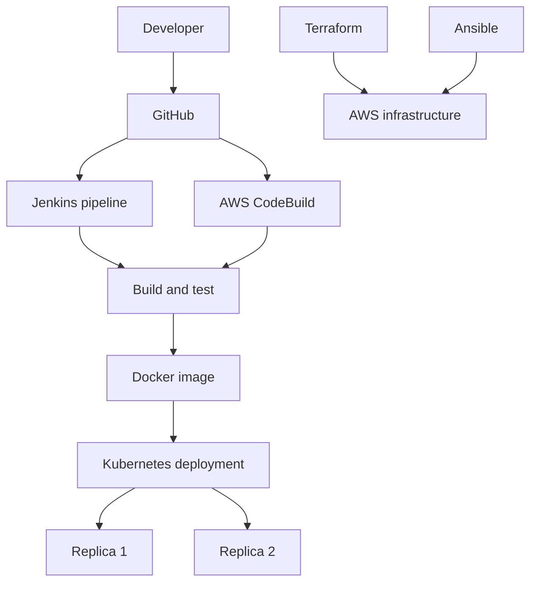

# DevOps CI/CD & AWS Infrastructure Project

A hands-on DevOps learning project that brings together source control, CI/CD automation, containerization, Kubernetes deployment, Infrastructure as Code, and configuration management.

> **Project status: In progress.** This repository currently contains starter configurations and an intended architecture. AWS infrastructure, CI/CD execution, container image publishing, and Kubernetes deployment have not yet been verified. Do not interpret the configuration files as proof of a successful deployment.

## Project objectives

- Manage application source code with Git and GitHub.
- Define a Jenkins pipeline for checkout, build/test, Docker image creation, and deployment.
- Prepare an AWS CodeBuild workflow.
- Package a Node.js application with Docker.
- Describe a Kubernetes Deployment with two replicas and a NodePort Service.
- Provision AWS infrastructure with Terraform.
- Configure Linux machines with Ansible.

## Technology stack

| Tool | Intended role |
|---|---|
| Git & GitHub | Version control and source repository |
| Jenkins | CI/CD pipeline orchestration |
| AWS CodeBuild | Managed build automation |
| Docker | Application containerization |
| Kubernetes | Container orchestration |
| Terraform | Infrastructure as Code |
| Ansible | Configuration management |
| AWS EC2 | Compute infrastructure |

## Intended architecture



The Jenkins and CodeBuild paths are planned integrations; they are not yet connected or validated end to end.

## Repository structure

```text
.
├── README.md
├── Jenkinsfile
├── Dockerfile
├── k8s/
│   └── deployment.yaml
├── terraform/
│   ├── main.tf
│   └── variables.tf
├── ansible/
│   └── site.yml
└── docs/
    └── architecture.md
```

## Configuration currently present

- **Jenkinsfile:** Checkout, Build & Test, Docker Build, and Deploy stages.
- **Dockerfile:** Uses Node.js 20 Alpine, installs production dependencies, copies application files, exposes port 3000, and starts the app with `npm start`.
- **Kubernetes manifest:** Defines a Deployment with two replicas and a NodePort Service configured for port 30008.
- **Terraform:** Configures the AWS provider and one EC2 controller instance. The AMI ID is supplied through a variable.
- **Ansible:** Installs Docker and ensures the Docker service is started and enabled.

## Important items to complete before deployment

The following gaps are known and must be resolved before an end-to-end run:

1. Add a real application source and its `package.json` with valid `npm ci`, test, and start scripts.
2. Replace the placeholder GitHub URL in the Jenkinsfile and configure Jenkins credentials securely.
3. Add and configure an AWS CodeBuild `buildspec.yml`, then connect the intended source trigger.
4. Build and publish the Docker image to a real container registry; replace the placeholder image in the Kubernetes manifest.
5. Review the Kubernetes cluster, image pull permissions, service exposure, and deployment settings.
6. Supply a valid AMI ID and review the Terraform resources, networking, security groups, state, and cost before applying.
7. Review Ansible inventory, privilege requirements, and OS-specific package/service names.
8. Add execution evidence only after each step succeeds.

## Safe setup and validation plan

Run these checks in the appropriate environment after installing the tools:

```bash
git clone https://github.com/swarajsalve042/devops-cicd-aws-infrastructure.git
cd devops-cicd-aws-infrastructure

# Inspect repository contents
git status
find . -maxdepth 3 -type f
```

Validate individual components only after their prerequisites are configured:

```bash
# Terraform syntax and configuration checks
terraform fmt -check -recursive
terraform init -backend=false
terraform validate

# Ansible syntax check (requires a valid inventory)
ansible-playbook -i inventory.ini ansible/site.yml --syntax-check

# Kubernetes manifest client-side validation (requires kubectl)
kubectl apply --dry-run=client -f k8s/deployment.yaml
```

These are validation commands, not deployment commands. A successful local syntax check does not prove that AWS resources or Kubernetes workloads are running.

## Deployment verification checklist

- [ ] Application builds and tests successfully.
- [ ] Jenkins pipeline completes successfully.
- [ ] CodeBuild build completes successfully.
- [ ] Docker image is built and pushed to the configured registry.
- [ ] Terraform plan is reviewed and approved before apply.
- [ ] AWS resources are visible and in the expected state.
- [ ] Kubernetes Deployment reports two available replicas.
- [ ] Kubernetes Service exposes the expected port.
- [ ] Application responds successfully through the configured endpoint.

## Security and cost notes

- Never commit AWS access keys, passwords, tokens, private keys, kubeconfig files, or other secrets.
- Use GitHub Actions/Jenkins/AWS secret stores or IAM roles as appropriate; grant only the permissions required.
- Review AWS region, instance type, networking, public exposure, and estimated charges before provisioning.
- Destroy temporary resources when they are no longer needed, after confirming that doing so is safe.

## Learning outcomes

This project is intended to build practical skills in Git workflows, CI/CD concepts, Docker image creation, Kubernetes manifests, Terraform, Ansible, and AWS cloud operations.

## Maintainer

**GitHub:** [@swarajsalve042](https://github.com/swarajsalve042)

Feedback and suggestions are welcome. The repository will be updated as each component is implemented and verified.
